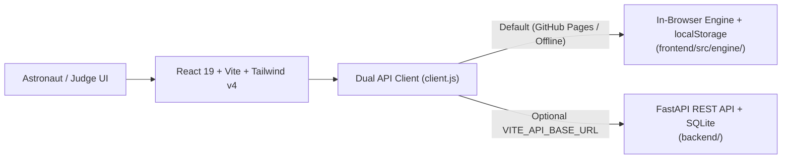

# EIMO | Astronaut Health CDSS

**Offline-first clinical-biophysical decision support system for autonomous crew health management across microgravity, lunar, and Martian habitats.**

> **Live Autonomous App (GitHub Pages — Zero Backend Required):**  
> - **Interactive App:** https://josiasemm.github.io/preccesion-pulse/  
> - **Direct Judge Demo Mode (`?demo=1`):** https://josiasemm.github.io/preccesion-pulse/?demo=1  

<kbd>React 19</kbd> &nbsp; <kbd>In-Browser Physics Engine</kbd> &nbsp; <kbd>localStorage</kbd> &nbsp; <kbd>Vite</kbd> &nbsp; <kbd>Tailwind CSS v4</kbd> &nbsp; <kbd>FastAPI + SQLite (Optional Local API)</kbd>

<br />

[Overview](#-overview) &nbsp;•&nbsp;
[Key Features](#-key-features) &nbsp;•&nbsp;
[NASA Data & References](#-nasa-data--references) &nbsp;•&nbsp;
[Architecture & Stack](#-architecture--stack) &nbsp;•&nbsp;
[Quickstart](#-quickstart)

---

> [!IMPORTANT]
> **Deep-space crews cannot rely on real-time Earth flight surgeons when communication latency reaches up to 44 minutes round-trip.**  
> **EIMO** pairs a deterministic, coupled biophysical engine (hydrostatics, cabin $\text{ppCO}_2$ conservation, radiation attenuation, bone/renal Wolff kinetics, and 3-layer organic-mimic exclusion) with an offline-first clinical interface, real-time $\Delta t$ simulation, interactive microgravity procedures, and Store-and-Forward emergency telemetry queuing.

---

## ↳ Overview

**EIMO (Engine for In-Flight Medical Operations)** transforms fragmented spacecraft telemetry and subjective crew check-ins into actionable clinical guidance:

1. **Coupled Biophysical Engine:** Evaluates five interconnected physiological systems using first-principles physics rather than isolated static thresholds.
2. **Multi-Gravity SWaP Matrix:** Adapts hardware availability, round-trip communication delay (ISS `0.05s`, Transit `854s`, Lunar Rover `2.6s`, Mars Base `1,501s` — up to ~44 min at solar conjunction), and gravitational loading (`0g`, `0.165g`, `0.38g`).
3. **Interactive Crew Workflow:** Combines passive telemetry monitoring, live $\Delta t$ integration, in-browser psychomotor vigilance screening (`30 s` adapted demo vs `180 s` NASA standard `PVT-B`), Web Audio relative dBFS audiometry, bilateral OD/OS Amsler grid screening (`ΔTRT250` unified OCT metric), `0.1 Hz` vagal breathing, and real CSV/JSON telemetry ingestion.
4. **Two-Lane Emergency Architecture:** Separates routine autonomous care (Lane 1) from acute red-flag stabilization (`ABCDE 0g + FAST`) and Store-and-Forward packet queuing to Mission Control (Lane 2).

### 🛡️ Platform Capabilities
- [x] **100% Autonomous Browser Execution + Continuous Local State**: Runs the full deterministic biophysical engine natively in the browser with `localStorage` persistence (GitHub Pages ready) or against the optional local FastAPI + SQLite server (`VITE_API_BASE_URL`)
- [x] **Real-Time $\Delta t$ Physics Step**: Integrates $\text{ppCO}_2$ buildup/CDRA removal and sympathetic/ONSD response over discrete time steps
- [x] **Interactive Countermeasures**: Toggle SPE storm shelter, potassium citrate, alendronate, pre-sleep window, and CDRA scrubber efficiency directly against the engine
- [x] **Store-and-Forward Queue (Lane 2)**: Queues acute emergency packets offline and syncs them when Earth link windows open
- [x] **CSV / JSON Telemetry Import**: Load multi-step mission telemetry logs directly into the evaluation pipeline

---

## ↳ Key Features

| Feature | Description | Target Benefit |
| :--- | :--- | :--- |
| **Anatomical Body Map** | Interactive 4-zone human silhouette with 9 live vital parameters (`ppCO₂`, `SpO₂`, `HR`, `BP`, `ONSD`, `Glucose`, `PVT-B`, `SPE Dose`, `BMD Loss`) | Immediate clinical situational awareness without visual clutter |
| **3-Layer Organic Exclusion** | Screens hypercapnia (`> 3.0 mmHg`), hypoxia (`SpO₂ < 94%`), and hypoglycemia (`< 70 mg/dL`) before diagnosing anxiety | Prevents mislabeling life-threatening environmental or metabolic failures as stress |
| **In-Browser Clinical Tools** | Real millisecond `PVT-B` reaction test, Web Audio pure-tone audiometry, Amsler grid, and `0.1 Hz` vagal resonance guide | Zero external hardware dependencies for daily/weekly crew screening |
| **Interactive 0g Protocols** | Step-by-step checklists for POCUS ONSD, DVT, i-STAT, LBNP, SPE shelter, and `ABCDE 0g + FAST` | Standardizes acute and preventive care under microgravity constraints |
| **Judge Demo Simulator** | One-click toggle with pre-configured mission anomalies (CDRA failure, SPE storm, pre-sleep insomnia, acute stroke) | Enables instant validation of coupled model behavior |

---

## ↳ NASA Data & References

All physiological thresholds, radiation limits, and clinical procedures in **EIMO** are grounded in the official **NASA Space Apps 2026 Challenge Resources** ([Health Monitoring Software](https://www.spaceappschallenge.org/2026/challenges/health-monitoring-software/)) and open aerospace medical standards:

### Official Space Apps 2026 Challenge Resources (NASA & CSA)
* **NASA Data & Resources:**
  * [5 Hazards of Human Spaceflight (NASA HRP)](https://www.nasa.gov/hrp/hazards/) — Core hazard architecture (radiation, isolation/confinement, distance from Earth, altered gravity, hostile closed environments).
  * [Risks of Human Spaceflight (NASA HRP)](https://www.nasa.gov/hrp/risks/) — Clinical risk mapping (SANS, immune dysregulation/viral reactivation, renal stone formation, DCS/hypoxia, sensorimotor).
  * [Ongoing HRP Research in Space (NASA HRP)](https://www.nasa.gov/hrp/ongoing-hrp-research/) — Active countermeasures and flight hardware references (ARCHeR, CIPHER, B-Complex, OCT, Thigh Cuff, Tempus Pro).
* **Space Agency Partner Resources (CSA — Canadian Space Agency):**
  * [Monitoring Radiation for Astronaut Health (CSA)](https://www.asc-csa.gc.ca/eng/news/articles/2026/2026-02-26-monitoring-radiation-astronaut-health.asp) — Space radiation dosimetry and neutron/ionizing monitoring context.
  * [Why Do We Conduct Science Experiments in Space? (CSA)](https://www.asc-csa.gc.ca/eng/iss/science/why-do-we-conduct-science-experiments-in-space.asp) — ISS physiology findings (space anemia, transient insulin resistance, bone loss) and Earth translation.

> *Note: NASA does not endorse any non-U.S. Government entity and is not responsible for information contained on non-U.S. Government websites (CSA partner resources linked for official challenge reference).*

| Standard / Source | Domain Applied in EIMO |
| :--- | :--- |
| **[NASA-STD-3001 Vol. 1 & Vol. 2](https://standards.nasa.gov/)** | Cabin $\text{ppCO}_2$ limits (`[V2 6004]`), continuous/intermittent acoustic noise limits (`[V2 6078]`, `[V2 6080]`), spacesuit $P_{I\text{CO}_2}$ (`[V2 11039]`), oxygen flammability `< 23.5%` (`[V2 11040]`), 30-day BFO radiation limits (`250 mGy-Eq`), and career effective dose (`< 600 mSv`) |
| **[OCHMO-STD-100.1A & Technical Briefs](https://www.nasa.gov/ochmo/hsa-standards/)** | Crew medical selection/waivers (`OCHMO-STD-100.1A`), $\text{CO}_2$ (`OCHMO-TB-004`), habitable atmosphere/hypoxia (`OCHMO-TB-003`), ionizing radiation (`OCHMO-TB-020`), orthostatic intolerance/EDL (`OCHMO-TB-019`, `OCHMO-TB-051`), SANS (`OCHMO-MTB-001`, unified $\Delta\text{TRT250}$), and urinary/renal health (`OCHMO-MTB-003`) |
| **NASA Human Research Program (HRP) & Brief PVT-B** | `30 s` rapid demo screening adapted from the 3-minute Brief Psychomotor Vigilance Test (`PVT-B`, lapse `≥ 355 ms`) |
| **[REMM (HHS Radiation Emergency Medical Management)](https://remm.hhs.gov/)** | Andrews lymphocyte depletion kinetics and serial CBC tracking for acute radiation biodosimetry |

### Superintelligence (SI) Disclosure
* **Deterministic Clinical Runtime:** In-flight evaluation in **EIMO** uses **zero generative models**—all triage decisions, safety locks, and alerts run 100% deterministically and offline via differential/algebraic equations and verified clinical thresholds.
* **Development Acceleration:** Superintelligence (SI) software engineering tools were used during hackathon design, equation verification, UI refactoring, and automated QA testing.

### Scientific Validation Boundary (Congress Transparency)
- **Exact Physics & Verified NASA/OCHMO Standards:** Stevin hydrostatic shift ($\Delta P = \rho \Delta g h$), dynamic Alveolar Gas Equation ($P_AO_2$ from `cabin_pressure_psia`, `cabin_o2_percent`, and $\text{ppCO}_2$), $\text{ppCO}_2$ conservation per habitable volume $V_{\text{cab}}$, NASA-STD-3001 thresholds (`[V2 6004/6078/6080/11039/11040]`, including $< 23.5\%$ O₂ flammability ceiling), BFO `250 mGy-Eq` / career `600 mSv`, and REMM Andrews biodosimetry triggers.
- **EIMO v1.0 Parametric Approximations:** First-order plasma volume decay ($\tau = 2.5\text{ d}$), mono-exponential SPE proton proxy ($\lambda_{\text{SPE}} = 12\text{ g/cm}^2$, reference areal shielding range $x_{\text{ref}} = 5\text{–}30\text{ g/cm}^2$), Wolff BMD loss ($\alpha = 1.4\%/\text{mo}$, asymptotically capped at $-35\%$), and scalar renal supersaturation index $I_{\text{renal}}$.

Sample telemetry datasets for testing CSV/JSON ingestion are included in [`data/`](data/):
- [`data/nominal_iss_day.csv`](data/nominal_iss_day.csv) — Nominal ISS day within NASA-STD-3001 thresholds.
- [`data/cdra_co2_failure_progression.csv`](data/cdra_co2_failure_progression.csv) — Multi-step CDRA scrubber degradation showing coupled $\text{ppCO}_2$, ONSD, and PVT-B progression.
- [`data/spe_solar_storm_transit.json`](data/spe_solar_storm_transit.json) — Acute Solar Particle Event (`380 mGy-Eq` BFO) during deep-space transit.

---

## ↳ Architecture & Stack



```text
space-apps-2026/
├── backend/                        # Optional FastAPI + SQLite local server & test suite
│   ├── main.py                     # FastAPI endpoints (/api/evaluate, /api/step, /api/history, /api/emergency-queue)
│   ├── physics_engine.py           # 5 coupled biophysical models + dt integrator
│   ├── swap_matrix.py              # Multi-gravity environment & SWaP hardware matrix
│   ├── database.py                 # SQLite persistence (baseline, evaluation logs, Lane 2 queue)
│   ├── protocolos.json             # Microgravity step-by-step clinical protocols
│   ├── test_engine.py              # Automated pytest suite
│   └── requirements.txt            # Python backend dependencies
├── frontend/
│   ├── src/
│   │   ├── App.jsx                 # 3-column dashboard, live dt loop, CSV/JSON import, state
│   │   ├── i18n.js                 # Bilingual ES/EN dictionary
│   │   ├── api/client.js           # Standalone local engine adapter + optional FastAPI transport
│   │   ├── engine/                 # 1:1 JS biophysical engine, SWaP matrix, scenarios, localStorage & protocolos.json
│   │   └── components/             # AnatomySvg, BodyMapSvg, LeftSidebar, TopHeader & clinical modals
│   ├── package.json                # Frontend metadata and scripts
│   └── vite.config.js              # Vite build config (VITE_BASE_PATH for GitHub Pages) & /api proxy
├── .github/workflows/
│   └── deploy-pages.yml            # GitHub Actions CI/CD build & deploy to GitHub Pages
├── data/                           # Sample CSV/JSON mission telemetry datasets
├── docs/images/                    # README visual assets
└── LICENSE                         # MIT open source license
```

---

### 🔌 FastAPI REST Endpoints

| Method | Endpoint | Query / Payload | Purpose |
| :--- | :--- | :--- | :--- |
| `GET` | `/api/environments` | `?lang=es\|en` | Returns localized SWaP vehicle profiles (`iss`, `transit`, `rover`, `mars_base`) |
| `GET` | `/api/protocols` | `?lang=es\|en` | Returns cached 10 localized 0g clinical protocols (`protocolos.json`) |
| `GET` | `/api/scenarios` | `?lang=es\|en` | Returns preconfigured Demo Mode clinical and environmental failure scenarios |
| `GET` | `/api/baseline` | — | Returns persisted crew baseline profile (with auto-resolved `age` and `mission_day`) |
| `POST` | `/api/baseline` | `BaselineProfile` | Saves or updates crew baseline profile in SQLite |
| `POST` | `/api/evaluate` | `TelemetryInput`, `?lang=es\|en&persist=true\|false` | Evaluates full 5-model physiological + SWaP state for submitted telemetry |
| `POST` | `/api/step` | `StepRequest` (`dt_minutes` `0..1440`), `?lang=es\|en` | Integrates discrete $\Delta t$ physics step and returns updated telemetry + evaluation |
| `GET` | `/api/history` | — | Returns last 15 persisted evaluations from SQLite |
| `DELETE` | `/api/history` | — | Clears `evaluation_logs` table while preserving baseline profile |
| `GET` | `/api/emergency-queue` | — | Lists Store-and-Forward Track 2 packets (`QUEUED_FOR_EARTH_LINK` / `TRANSMITTED_TO_MCC`) |
| `POST` | `/api/emergency-store-forward` | `EmergencyPacketRequest`, `?lang=es\|en` | Creates or updates an active queued Track 2 emergency packet (post-sync creates a new packet) |
| `POST` | `/api/emergency-queue/sync` | — | Marks all queued Track 2 packets as `TRANSMITTED_TO_MCC` |
| `POST` | `/api/emergency-queue/{packet_id}/sync` | `packet_id` path param | Marks a single queued packet as transmitted when RTT expires |
| `DELETE` | `/api/emergency-queue/transmitted` | — | Deletes transmitted Track 2 packets while keeping active queued ones |

---

## ↳ Quickstart

### Prerequisites
* **Python** 3.11+
* **Node.js** 18+

### 1. Start the Backend (FastAPI)

```bash
cd backend
python3 -m venv .venv
source .venv/bin/activate
pip install -r requirements.txt
uvicorn main:app --reload
```

Run the backend test suite:

```bash
pytest -q
```

### 2. Start the Frontend (React + Vite)

```bash
cd frontend
npm install
npm run dev
```

Open `http://localhost:5173` in your browser (or `http://localhost:5173/?demo=1` to skip onboarding and launch directly in **Judge Demo Simulator** mode).

---

## ↳ License

Distributed under the MIT License. See [LICENSE](LICENSE) for details.

<br />

<div align="center">
  
</div>
